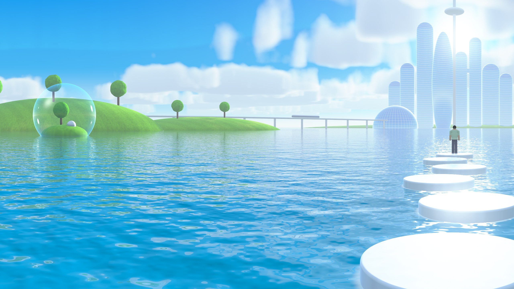

# NodeGet Aero 主题

[NodeGet](https://github.com/NodeSeekDev/NodeGet) 公开展示页的一个主题，Frutiger Aero 风格：蓝天、水、玻璃、肥皂泡，界面是毛玻璃面板和水位球。原生 JS，没有依赖，不需要构建。



背景是一张三维渲染的画「被许诺的未来」：水上一串白色石阶通向远处的玻璃城，穿浅绿厂服的人背对着我们站在最后一块上；另一侧浮着一颗罩住小岛的玻璃球。整张画由 `tools/scene/scene.frag` 这个着色器按几何和光算出来（光线步进），没有贴图和模型。上面这张是底图，页面里的水面、肥皂泡和风车是实时画的。

## 有什么

- 总览：在线数、平均 CPU 和内存、实时网速和累计流量
- 节点列表：CPU、内存、磁盘、上下行、运行时长、CPU 趋势线，可按地区筛选
- 节点详情：资源水位球、24 小时在线条、近 10 分钟趋势、TCP 延迟曲线（30 分钟 / 6 小时 / 24 小时，带均值、抖动、丢包）、系统信息
- 节点分布地图（打开时才加载）
- 昼夜两套画面，可切换；「看画」按钮可以收起面板只看背景；「动效」按钮可以让画面停住
- 桌面和手机竖屏都适配

## 使用

1. 复制配置并填写：

   ```bash
   cp src/config.example.json src/config.json
   ```

   - `site_tokens[].backend_url`：NodeGet 后端的 RPC 地址（`wss://…/nodeget/rpc`）
   - `site_tokens[].token`：只读的访客令牌。它会出现在公开页面里，只给读监控数据的权限。如果你在后端前面放了自己注入令牌的只读代理，这里留空
   - `user_preferences`：站点名 `site_name`、图标 `site_logo`、页脚 `footer`、旗帜替换 `flag_map`（格式 `TW=CN`，多个用逗号分隔，留空则不替换）、画名 `caption`

2. 把 `src/` 下的文件放到任意静态托管上即可。用 NodeGet 自带的静态桶时，在面板的 Static Buckets 里新建一个桶、把文件放进去、设为 HTTP 根。

页面只调用这几个只读的 RPC 方法：`nodeget-server_list_all_agent_uuid`、`agent_static_data_multi_last_query`、`agent_dynamic_summary_multi_last_query`、`agent_query_dynamic_summary`、`kv_get_multi_value`、`task_query`。

## 目录

- `src/` 部署用的全部文件
  - `index.html` 页面骨架；`aero.css` 样式；`aero.js` 数据与界面
  - `live.js` 背景的实时图层：水面、肥皂泡、风车、光束、云影、极光都是它现算的
  - `scene-day.jpg` / `scene-night.jpg`（2560×1440）和带 `-s` 的小尺寸（1600×900）：昼夜两张底图，里面没有肥皂泡和风车
  - `scene-mask.png` / `scene-mask-s.png`：遮罩，红色是露着的水面，绿色是天空，实时图层靠它知道哪里该画水
  - `map.json` 简化后的世界地图
  - `config.example.json` 配置样例；`custom.css` / `custom.js` 留给自己加东西
- `tools/scene/` 场景：`scene.frag` 是画本身，`index.html` 是出图工具
- `tools/dev-server.mjs` 本地预览
- `tools/build-map.py` 生成 `map.json`

## 本地预览

```bash
node tools/dev-server.mjs
```

然后打开 http://localhost:4173 。改 `src/` 里的文件，页面会自己刷新。预览服务会把页面的数据连接转给 `src/config.json` 里配置的后端，所以本地也能看到真实数据。

## 画面是怎么动起来的

底图是渲染好的静态成片，访客的浏览器不用跑光线步进。`live.js` 在它上面叠一张画布，每帧只做几件便宜的事：

- 水面：对遮罩里标成水的像素，按随时间移动的波浪算法线，倒影直接取底图里地平线以上的部分，再加菲涅耳、碎光、石阶和玻璃球周围的水线。
- 肥皂泡、风车：解析地求交，位置和 `scene.frag` 里一致。
- 光：太阳周围慢慢转的光束、滑过水面的云影；夜里极光在流动。

没有 WebGL2 时 `live.js` 什么都不做，页面显示静态底图。系统开了「减少动态效果」时画面默认停住。帧时间一直偏长会自动降分辨率，再不行就隔帧绘制。

## 构图约定

信息面板在页面中间，所以画面的主体放在两侧：左边一组在画面宽度的 12.5% 处（玻璃球、草丘、风车），右边一组在 87.5% 处（石阶、人、玻璃城、太阳），中间只留水面、天和远处的单轨。镜头是柱面投影，两侧的球不会被拉成椭圆。竖屏时背景会平移，让右边那组落在屏幕中间。

## 改画面

改 `tools/scene/scene.frag`，启动本地预览后打开 `http://localhost:4173/__scene/?w=1600&h=900&spp=8` 看效果（改动后自动重渲染；不带 `mode` 时是带肥皂泡和风车的完整画面）。满意后依次出六张，每张渲染完在浏览器控制台里执行对应的 `save(...)`：

| 地址参数 | 保存 |
| --- | --- |
| `?w=2560&h=1440&spp=32&bands=48&q=0.88&mode=1` | `save('scene-day.jpg')` |
| `?w=1600&h=900&spp=32&bands=24&q=0.88&mode=1` | `save('scene-day-s.jpg')` |
| `?w=2560&h=1440&spp=32&bands=48&q=0.88&mode=1&night=1` | `save('scene-night.jpg')` |
| `?w=1600&h=900&spp=32&bands=24&q=0.88&mode=1&night=1` | `save('scene-night-s.jpg')` |
| `?w=2560&h=1440&spp=16&bands=48&mode=2` | `save('scene-mask.png')` |
| `?w=1600&h=900&spp=16&bands=24&mode=2` | `save('scene-mask-s.png')` |

`mode=1` 出底图，`mode=2` 出遮罩。出完图把 `aero.css` 和 `live.js` 里 `scene-*` 后面的 `?v=` 一起改掉（两处要一致，浏览器才只下载一次）。如果挪了镜头、石阶、玻璃球、风车或肥皂泡的位置，`live.js` 着色器开头的那几组常量也要跟着改。

改了 `aero.css`、`aero.js` 或 `live.js` 后，把 `index.html` 里对应的 `?v=` 也改掉，避免 CDN 和浏览器继续用旧缓存。

## 开销

- 服务器：页面和图片都是静态文件。一条 WebSocket，每 2 秒取一次实时数据，页面不可见时停止轮询，一分钟后断开连接。列表趋势线进页面时每台只取 60 行 CPU；详情里的延迟图 30 分钟档一次查询，6 小时 / 24 小时档按时间格抽样。
- 浏览器：实时图层是一个全屏的片元着色器，每个像素几次纹理采样加十几次噪声。面板的毛玻璃用 `backdrop-filter`。

## 数据来源

`map.json` 由 [Natural Earth](https://www.naturalearthdata.com/) 的 1:50m 国家边界（公有领域）简化而来，见 `tools/build-map.py`。

## 许可

[MIT](LICENSE)。代码、着色器和背景画都按这个许可发布。
